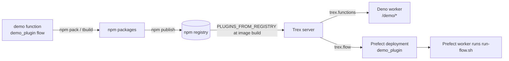

# Integrating Flows and Functions with Trex as a Plugin

Trex loads extensions as **npm packages** whose `package.json` carries a `trex`
block. D2E ships two such packages from `plugins/`:

| Kind | Package | Source | `trex` key | Runs as |
|------|---------|--------|------------|---------|
| Functions (Deno/Express) | `@data2evidence/d2e-functions` | `plugins/functions` | `trex.functions` | HTTP endpoints in Deno EdgeRuntime workers |
| Flows (Python/Prefect) | `@data2evidence/d2e-flows` | `plugins/flows/base` | `trex.flow` | Prefect deployments, run by a Prefect worker using the D2E flow image |

Generic field references live in the Trex docs
(`trex/plugins/docs/docs/plugins/function-plugins.md` and `flow-plugins.md`).
This guide applies them to D2E code.

## Running example

Every step below uses the same pair, so you can follow one thread end to end:

| | Name | Location |
|---|------|----------|
| Function | `demo` | `plugins/functions/demo/` (already in the repo and already registered; shown here as the reference to copy) |
| Flow | `demo_plugin` | `plugins/flows/base/demo_plugin/` (illustrative; you create it) |

For your own work, replace `demo` / `demo_plugin` with your names. The existing
`demo` function is a setup/provisioning service; use it as the pattern for
layout and registration.



At startup Trex reads each installed package's `trex` block. Functions are
mounted as HTTP routes; flows are registered as Prefect deployments.

**Before you start:** you need Node/npm and Deno for functions, Python (via
pixi) for flows, and Docker to run the stack. Check the repo `README.md` for
versions. How the two packages are published to the feed is outside this
guide; ask the team how your change gets released.

---

## Step 1: Write the code

### Function: `demo`

```
plugins/functions/demo/
  index.ts       # entrypoint
  deno.json      # import map
  controllers/ services/ api/ ...
```

```ts
// plugins/functions/demo/index.ts
import express from "express";
import { DemoController } from "./controllers/DemoController.ts";

const app = express();
app.use(express.json());
app.use("/demo", new DemoController().router);
app.listen(8000);
```

```json
// plugins/functions/demo/deno.json
{
  "nodeModulesDir": "auto",
  "imports": { "express": "npm:express@^4.18" }
}
```

### Flow: `demo_plugin`

```
plugins/flows/base/demo_plugin/
  __init__.py
  flow.py        # @flow entrypoint
  types.py       # pydantic options model
```

```python
# plugins/flows/base/demo_plugin/types.py
from pydantic import BaseModel

class DemoPluginOptions(BaseModel):
    message: str = "hello"
```

```python
# plugins/flows/base/demo_plugin/flow.py
from prefect import flow, get_run_logger

from .types import DemoPluginOptions


@flow(log_prints=True)
def demo_plugin(options: DemoPluginOptions):
    get_run_logger().info(options.message)
```

Shared helpers go in `plugins/flows/_shared_flow_utils`; they are vendored into
the package at pack time (Step 3).

---

## Step 2: Register in the manifest

### Function: `plugins/functions/package.json`

The following is a **simplified manifest-shape example**, not the existing `demo` configuration. For the actual setup service, retain its complete environment block and `demo.setup` scope in `plugins/functions/package.json`; a new function adds its own entries in the same shape:

```json
{
  "trex": {
    "functions": {
      "api": [
        {
          "source": "/demo",
          "function": "/demo",
          "imports": "/demo/deno.json",
          "env": "demo"
        }
      ],
      "env": {
        "_shared": { "MINIO__ENDPOINT": "${MINIO__ENDPOINT:-d2e-minerva-s3}" },
        "demo":    { "DEMO__LOG_LEVEL": "${DEMO__LOG_LEVEL:-info}" }
      },
      "roles":  { "DEMO_USER": ["demo.read"] },
      "scopes": [
        { "path": "^/demo/(.*)", "scopes": ["demo.read"], "httpMethods": ["GET", "POST"] }
      ]
    }
  }
}
```

- `function` is the worker **directory** (containing `index.ts`), not a file.
  A file path fails with `could not find an appropriate entrypoint`.
- The route is mounted at the bare `source` path, here `/demo/*`. (Only the
  `@trex/` and `@ohdsi/` scopes are mounted under
  `${PLUGINS_BASE_PATH}/<scope>/<source>/*`.)
- Trex forwards the request to the worker, and your Express app mounts the
  controller at the same path (`app.use("/demo", ...)`).
- `env`: `_shared` is merged into every function; the block named by
  `api[].env` (`demo`) is merged on top. `${VAR}`, `${VAR:-default}`,
  `${VAR-default}`, `${VAR:?error}` and `${VAR:+alt}` are substituted when the
  config loads, not in the worker. Workers get no database secrets
  automatically; pass what they need through `env`.
- Auth: callers send a Trex-issued access token from the D2E sign-in flow, which
  Trex verifies before forwarding to the worker (the worker only decodes it). Logto is only an upstream sign-in
  provider in `logto-federated` mode. `roles` are created in `trexdb.role` at
  startup. `scopes[].path` is a **regex** (see `^/files-manager/api` in the
  existing manifest), optionally limited by `httpMethods`, and the first match
  wins, so list the most specific first.
- Optional one-shot setup goes in `trex.functions.init`, for example the
  existing `*-init` directories. Add `waitforEnvVar` to poll a URL first and
  `eszip` to load a prebuilt bundle. Inits run sequentially in declaration
  order.

### Flow: `plugins/flows/base/package.json`

**Append** this object to the existing `trex.flow.flows` array (`trex.flow.image`
is already set):

```json
{
  "name": "demo_plugin",
  "entrypoint": "flows.demo_plugin.flow.demo_plugin",
  "command": "/app/run-flow.sh d2e-flows",
  "tags": ["demo"],
  "parameter_openapi_schema": {
    "title": "Parameters",
    "type": "object",
    "properties": {
      "options": { "$ref": "#/definitions/DemoPluginOptions", "position": 0, "title": "options" }
    },
    "required": ["options"],
    "definitions": {
      "DemoPluginOptions": {
        "title": "DemoPluginOptions",
        "type": "object",
        "properties": { "message": { "title": "Message", "default": "hello", "type": "string" } }
      }
    }
  }
}
```

| Field | Notes |
|-------|-------|
| `name` | Flow and deployment name in Prefect. |
| `entrypoint` | `flows.<plugin_dir>.<module>.<function>`. The staging script reads the plugin directory from the second segment, so keep this shape. |
| `image` | Docker-worker compatibility metadata, inherited from `trex.flow.image` if omitted. D2E's default process work pool accepts but ignores it; flows run inside `alp-dataflow-gen-worker`, with the plugin's pixi environment selected by `/app/run-flow.sh`. |
| `command` | Command the worker runs. D2E uses `/app/run-flow.sh d2e-flows`; the last argument is the **plugin group name** (the package, `d2e-flows`); keep it as is. |
| `tags` | Prefect tags. |
| `concurrencyLimitOptions` | `[{ "tag", "limit" }]`; `limit` is a number or an env var name (see `create_cachedb_file_plugin`). |
| `parameter_openapi_schema` | JSON schema of the flow function's parameters, including the outer `options` property. Generate it with Prefect's `parameter_schema_from_entrypoint(...).model_dump_for_openapi()` (see `plugins/flows/docs/scripts/packageutils.py`), and regenerate when the signature or options change. |
| `type`, `datamodels` | D2E-specific metadata that dataset/portal services use to find flows by purpose (for example `datamodel`). Optional for a plain flow. |

The Prefect connection is configured on the Trex server by whoever deploys it.

---

## Step 3: Build and package

### Function

```bash
cd plugins/functions
npm install
npm run build        # runs `tbuild .`; prebuild copies package.json to package.org.json
```

### Flow

`package.json` `files` is an allowlist (`flows`, `_shared_flow_utils`,
`__init__.py`, `pyproject.toml`, `pixi.lock`, `renv.lock`, setup scripts), and
npm lifecycle hooks stage and clean that layout:

```json
"scripts": {
  "prepack":  "bash ../build/stage_package.sh",
  "postpack": "bash ../build/stage_package.sh clean"
}
```

`stage_package.sh` copies each directory named in the `entrypoint` values
(here `demo_plugin`) into `flows/demo_plugin/` and vendors `_shared_flow_utils`.
A flow is only packaged if its `entrypoint` is in the manifest, and the script
fails if the directory is missing.

```bash
cd plugins/flows/base
npm pack --dry-run   # confirm flows/demo_plugin and _shared_flow_utils are listed
```

**Image.** The flow image is the D2E dataflow-gen worker image, built from
`services/alp-dataflow-gen-worker/Dockerfile` (CI publishes it as
`d2e-dataflow-gen-worker`; the manifest's `image` value
`ghcr.io/ohdsi/d2e/flow-base` is the name Trex hands to Prefect; the default
process pool ignores it). It provides
`/app/run-flow.sh` and bakes in `plugins/flows` with its pixi/R environments.
`run-flow.sh` finds the plugin code from the deployment's `plugin_artifact` or,
failing that, from that baked cache. CI rebuilds the image when files it copies
change; it also needs a rebuild when the flow adds new system, Python or R dependencies (`pyproject.toml`,
`pixi.lock`, `renv.lock`).

---

## Step 4: Test locally

Run the stack with `docker-compose-local.yml`, which bind-mounts your source
into the Trex container so you can test without publishing anything.

**Function.** `plugins/functions` is mounted into the Trex container
(`/usr/src/plugins/d2ef` and `/usr/src/bundled-plugins/d2e-functions`). Edit
`plugins/functions/demo/` and `plugins/functions/package.json`, then restart the
`trex` container; no image rebuild is needed.

**Flow.**
- Unit test the flow code first with `pytest`. Existing tests sit next to each
  plugin, for example `plugins/flows/base/create_cachedb_file_plugin/tests`.
- To run changed flow code without rebuilding the image, first register the
  entrypoint in the manifest, then run `bash ../build/stage_package.sh` from
  `plugins/flows/base`. Create `/usr/src/flows-dev/d2e-flows/` in the running
  Trex container and copy the staged `flows/`, `_shared_flow_utils/`, and
  `__init__.py` there. This shared volume is visible to the worker at
  `/var/lib/d2e-flows-dev/d2e-flows/`. Set
  `D2E_FLOWS_DEV_DIR=/var/lib/d2e-flows-dev` in the local Compose environment
  and recreate `alp-dataflow-gen-worker` to apply it. The overlay uses the
  existing provisioned environment; dependency changes still need provisioning.
  Repeat staging and copying after code edits. After copying, clean the staging
  files with `bash ../build/stage_package.sh clean` from `plugins/flows/base`.
- To load changes to `plugins/flows/base/package.json`, add the bind mount
  `./plugins/flows/base/package.json:/usr/src/bundled-plugins/d2e-flows/package.json`
  to the `trex` service in `docker-compose-local.yml`, then recreate `trex`.
  Use the staged code overlay above for the flow source. The existing commented
  manifest mount under `/usr/src/plugins` is shadowed by the bundled package.

Then do the checks under **Verify** below.

---

## Step 5: Deploy and verify

The Trex image bakes plugins in at build time:

- **Released plugins:** `PLUGINS_FROM_REGISTRY` (a build arg in
  `docker-compose-local.yml`) lists the npm packages to pull from the D2E feed.
  `@data2evidence/d2e-functions` and `@data2evidence/d2e-flows` are already in
  the default list, so a new function or flow ships once a new version of those
  packages is published and the image is rebuilt.
- **CI:** builds use the packed tarballs in `plugin-artifacts/` instead of the
  feed.
- **Local development:** add a bind mount such as
  `./plugins-dev/my-plugin:/usr/src/plugins-dev/my-plugin` to the `trex` service,
  place the package in that host directory, and recreate `trex` using the same
  Compose files as the running stack. `PLUGINS_DEV_PATH` discovers container
  paths, not unmounted host directories.

Only a brand-new package (not a new function or flow inside these two) must be
added to `PLUGINS_FROM_REGISTRY`.

Verify:

- **`demo` function:** call a route from `DemoController`, for example `GET /demo/progress/<id>` or `POST /demo/setup`, and check it responds. See Troubleshooting if you get an error.
- **`demo_plugin` flow:** it shows up on the **Jobs** page in D2E, and you can start a run from there.

## Troubleshooting

| Symptom | Likely cause |
|---------|--------------|
| `demo` returns `could not find an appropriate entrypoint` | `function` points at a file, or at a directory without `index.ts`. |
| `demo` returns 401/403 | Missing or invalid Trex-issued access token, or the caller's role lacks the scope matched by `scopes[].path`; check ordering (first match wins). |
| Env value empty in the worker | `${VAR}` was unset when the config loaded; use `${VAR:-default}` or `${VAR:?msg}`. |
| `demo_plugin` never registers | Flow plugins are skipped when the server has no Prefect connection, or the worker pool does not exist yet. Ask whoever runs the Trex server. |
| `npm pack` fails with `plugin dir 'demo_plugin' ... not found` | `entrypoint` names a directory that does not exist under `plugins/flows/base`. |
| Deployment runs but the flow is missing in the container | The plugin code was not provisioned: check the flow run's `run-flow.sh` output for the artifact or cache lookup. |

## Checklist

**Function (`demo`)**

- [ ] `plugins/functions/demo/` has `index.ts` and `deno.json`
- [ ] `trex.functions.api` entry added (`source`, `function`, `imports`, `env`)
- [ ] `env`, `roles` and `scopes` added if the function needs them
- [ ] `npm run build` in `plugins/functions` succeeds

**Flow (`demo_plugin`)**

- [ ] `plugins/flows/base/demo_plugin/` has `flow.py` and `types.py`
- [ ] `trex.flow.flows` entry added with entrypoint `flows.demo_plugin.flow.demo_plugin`
- [ ] `parameter_openapi_schema` regenerated from the flow entrypoint (full parameter schema, including `options`)
- [ ] `npm pack --dry-run` lists `flows/demo_plugin` and `_shared_flow_utils`
- [ ] If the flow adds new dependencies, `pyproject.toml` / `pixi.lock` / `renv.lock` updated and the flow image rebuilt

**Verify**

- [ ] A `/demo/...` route responds
- [ ] `demo_plugin` appears on the Jobs page in D2E and a run starts
