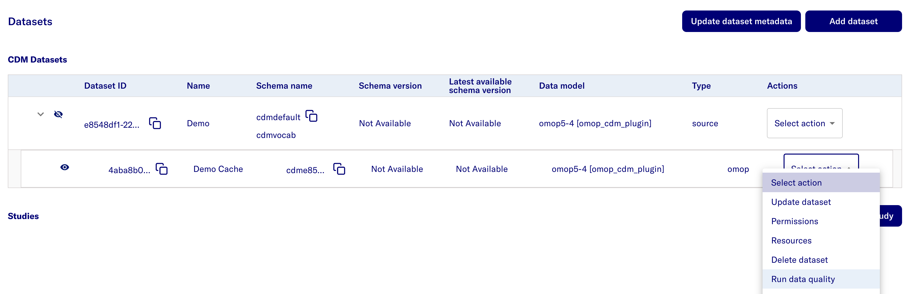
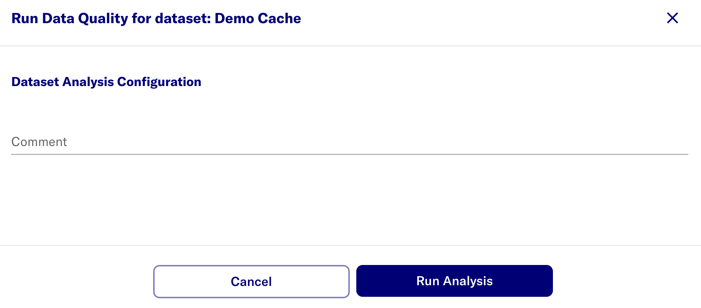
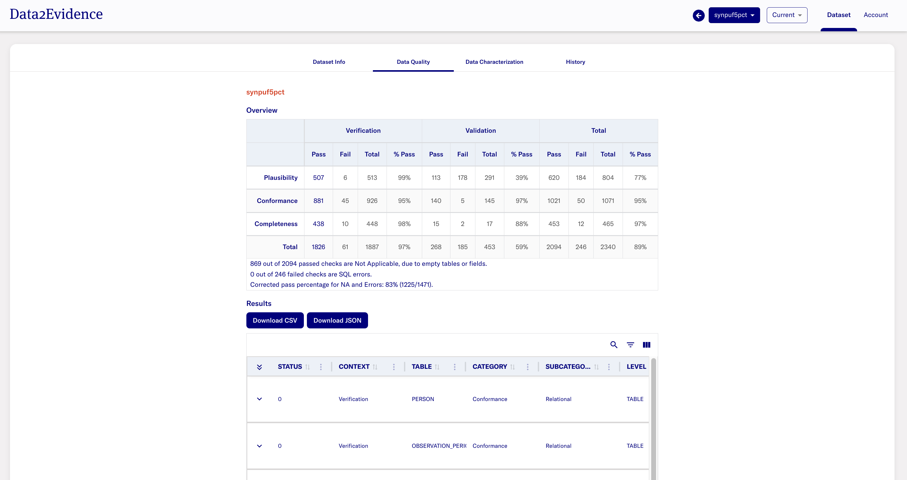

# Data Quality job

- In the Admin Portal, go to **Datasets** and click **Select Action** on the dataset of interest. For a legacy source dataset, expand it and use its cache dataset.
- Select **Run data quality**

- Select the **Run Analysis** button.

- After completing the Data Quality job run, the dashboards is available through the researcher portal.

