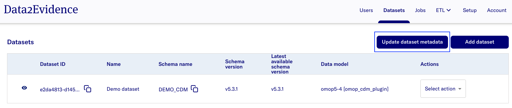
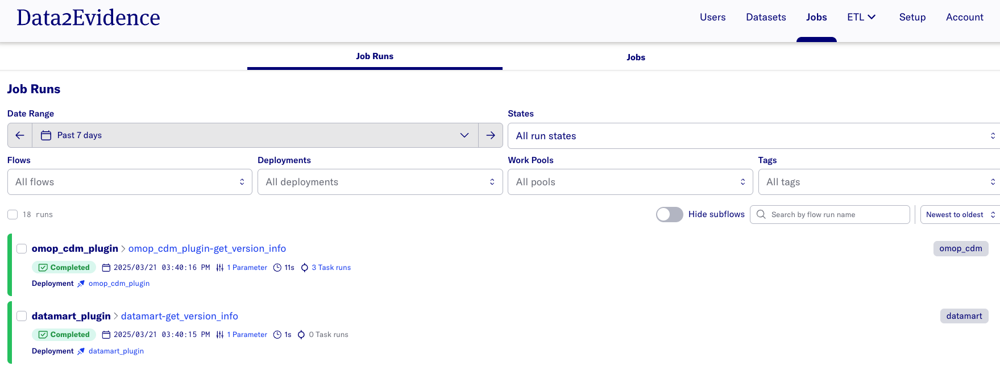
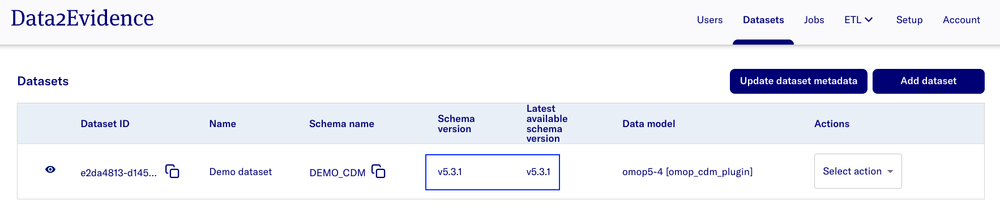
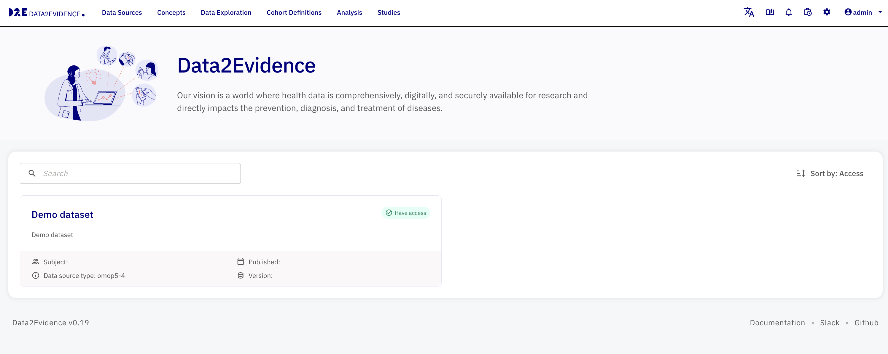
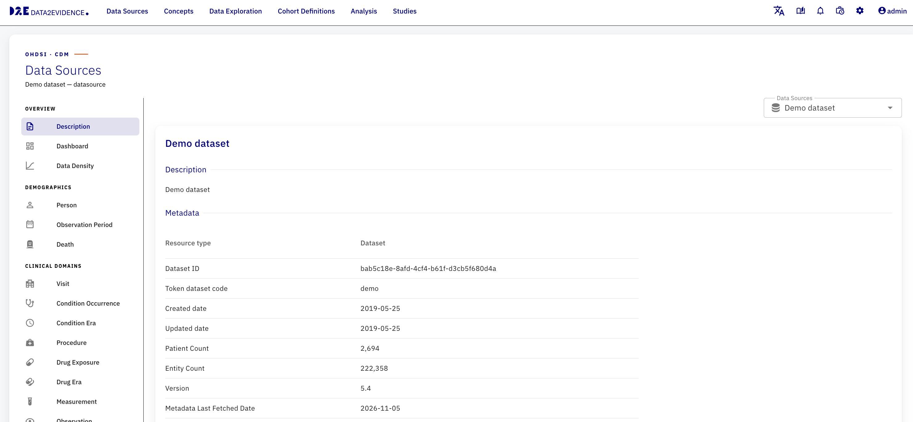

# Fetch metadata for datasets

To fetch metadata for datasets, click the `Update dataset metadata` button in the `Datasets` tab

This should trigger a job to run in the background which will update the following metadata:

- Current Schema Version
- Latest Available Schema Version
- CDM Version (OMOP data models only)
- Patient Count (OMOP data models only)
- Total Entity Count (OMOP data models only)

Current Schema Version and Latest Available Schema Version are displayed on the datasets page

For OMOP data models:

- The dataset card on the Atlas home page shows the updated subject count and schema version if data is present in the schema
- Total Subjects is based on the Patient Count
- The full metadata (Dataset ID, Entity Count, Patient Count, Schema Version, Latest Available Schema Version, Metadata Last Fetched Date) can be viewed on the dataset's **Description** page in Atlas

> **The expected display is:**
> 
> 
